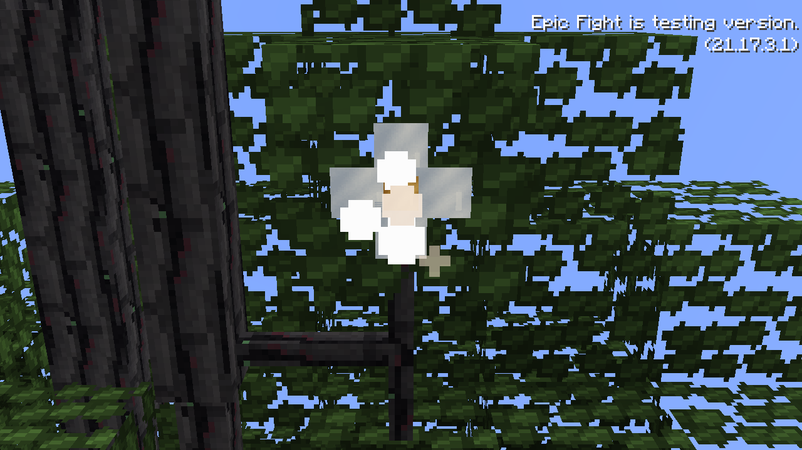
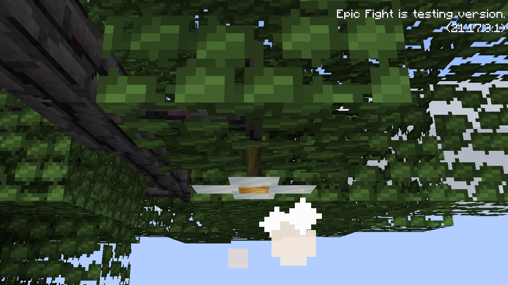

# Heartwood fruit

Fruit grows beneath Heartwood leaves near fine branch endpoints through the species’ normal Dynamic Trees generation and live-growth hooks. Planted and wild trees use the same fruit block and lifecycle. New live-growth organs begin as buds; wild trees can start with organs at different ages.

| Stage | Loaded living-tree time |
| --- | --- |
| Green bud | 0–8 minutes |
| White flower, with drifting particles | 8–16 minutes |
| Silver fruit | 16–30 minutes |
| Ripe gold fruit | 30–40 minutes |
| Falls as a collectible ripe fruit | 40 minutes |

Every stage connects to the underside of a Heartwood leaf through a flat, double-sided stem at most three model pixels long, rather than a long exposed stem from bare wood. Silver and gold fruit have softly emissive markings. Harvest a gold fruit by using it; a fresh bud begins at that attachment point. Leaving it ripe for ten minutes sheds the fruit and also begins a new bud. Immature organs do not drop ripe food. Growth pauses when the living root is unloaded or absent; time offline does not advance it.

Eating ripe fruit restores four food points and grants Regeneration I for ten seconds. A shapeless crafting recipe turns one fruit into one existing Heartwood seed.

A dropped ripe fruit resting on suitable ground for two loaded minutes attempts to plant the species’ ordinary Dynamic Trees sapling. It consumes one fruit from a stack, not the whole stack, and cannot overwrite an existing sapling. Moving, floating or picking up the fruit resets its settling time. Unsuitable ground does not produce a sapling; ordinary item despawning still applies.

Operator inspection: `/legacytree fruit <x> <y> <z>` reports stage and age. Add `advance <minutes>` to advance an attached organ for development previews.

Assets are generated with `python3 tools/assets/generate-heartwood-fruit.py`. Release checks cover native generation, saved fruit age/root, stage transitions, delayed drop, one-item sapling planting, regeneration and the seed recipe. The white flower is eight pixels across, with flat double-sided petals.

