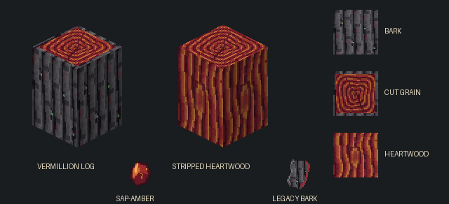

# Heartwood tree

An ancient, mana-nurtured hardwood. The species is named **Heartwood**; “legacy” describes its massive, ancient scale, rather than its name. Internal `vermillion_legacy` identifiers and `/legacytree` remain for saved-world and command compatibility. The current development portion targets **Manaheart Grove, the center biome**. Its adult trunk spans **three blocks across**, excluding its root system; this is not the size of one inventory log, nor a fixed trunk width at every growth stage. Wild trees are snapshots of real seed-grown trees, using the same living branches, leaves and subsequent growth rules. There is no independently authored wild-tree scaffold. Surface roots spread from the flared base, alongside an underground anchoring network.

Its exterior is rough, mineralized ash-grey bark, with tiny green mana veins in the fissures. Dense heartwood has deep burgundy/red-amber coloring, tight growth rings and dark gold grain. The future artisan-polished finish should be jewel-like while remaining recognizably wood. Its difficulty of working and desirability to kings and artisans are part of the material design.

## First living-tree prototype

- Dynamic Trees family/species: `riftfall:vermillion_legacy`; branch radius grows up to 24 pixels. Mature trees retain a radius-24 lower bole for their first five trunk segments, then taper into the scaffold. Seedlings and slender juveniles retain normal growth.
- Three native JoCodes come from planted seedlings grown for 9,600 growth pulses. Their branch layouts and measured radii are recorded in `tools/trees/legacy-grown-samples.json`; generation restores those measurements because JoCodes alone omit thickness. All use ordinary Dynamic Trees branch geometry.
- Shared Heartwood growth logic builds three irregular leaf-shelf layers, roughly six blocks apart, with staggered forks, unequal lateral fans and occasional one-block arches. Branch energy is 28–31; established branches retain Dynamic Trees' normal growth routing. A flat 7×3×7 hydration cluster keeps foliage close to the supporting twigs.
- The same underground-root, mature-bole and tapered surface-root features serve planted and wild trees. The first five lower trunk segments can reach radius 24; younger trees remain slender.
- The Heartwood leaf-support kit serves both growth and world generation. Neutral leaf textures use vanilla biome foliage tinting through the primitive leaf color handler; the species supplies no fixed leaf color. Manaheart Grove grass and foliage are both `#63B36B`. Other biome colors are unchanged.
- Felling leaf loot yields sticks but no seeds. Seeds remain available for planting; individual leaf-breaking and normal dispersal rules are unchanged.
- Living branches retain diamond-axe harvesting/stripping and failed-strike durability wear. Each broad surface patch can be stripped independently, yielding one bark item the first time that patch is stripped.

To place a grown reference, stand on clear ground with roughly 55×55 blocks of open space and 50 blocks of headroom, then run:

```mcfunction
/legacytree ~ ~-1 ~
```

The coordinates identify the **soil block**, not the first trunk block. This operator preview command places a captured grown tree and underground roots immediately. For normal growth, obtain `/give @s riftfall:vermillion_legacy_seed`, plant it on soil and use Dynamic Trees' ordinary growth mechanics.

Heartwood trees also generate naturally in **new Manaheart Grove chunks**, through Dynamic Trees' normal biome-decoration feature. One jittered anchor per 4×4-chunk grove cell keeps neighboring trunk centers at least 48 blocks apart. Natural crowns reserve a margin for leaf ageing inside Minecraft's 3×3-chunk feature-write area; manual previews keep the full crown. Other rings select temporary Dynamic Trees jungle species. See [biome integration](dynamic-trees.md). Existing crowns are not rewritten; existing Heartwood trees can gain surface roots on growth. No terrain elevation changes are included.

Thick trunk end grain uses complete, directly authored 96px animation frames for ordinary and stripped log tops, explicitly registered in `assets/minecraft/atlases/blocks.json`. Dynamic Trees’ thick-ring expander treats a vertical animation strip as one image and produces blank enlarged frames; these assets bypass that conversion while retaining the required `_thick` sprite names. Every frame remains opaque and only the mana tint changes subtly.

### Inspecting growth

Use `/legacytree inspect` while looking at a trunk, or `/legacytree inspect <tree position>`. The copyable report includes trunk diameter, height, spread, branch/tip counts, soil fertility and changes since the previous inspection. Maximum trunk thickness is not a final-stage flag. Depleted soil can pause growth; no observed change does not prove the tree is finished.

Dynamic Trees has no final adult-stage flag or stored growth age. Its `/dt gettree`, `/dt getroots`, `/dt fertility` and growth tools are useful, but do not supply that missing stage information.

`/legacytree export <tree position>` writes native canopy/root JoCodes and measured branch radii into the world's `legacy-tree-captures` directory. To update packaged references, deliberately select captures of planted seedlings, record their provenance and growth conditions in `tools/trees/legacy-grown-samples.json`, then run `python3 tools/trees/generate-legacy-shapes.py`. This packages captures; it does not design a separate tree.

Existing crowns are not rewritten. Inspect new chunks or use `/legacytree` for the updated references.

Client review: [seed-grown canopy](previews/heartwood-canopy.png), [view from above](previews/heartwood-canopy-above.png) and [branch connections from underneath](previews/heartwood-canopy-under.png). These show the accepted growth shape before fruit and healing were added.

## Implemented materials

| ID | Purpose |
| --- | --- |
| `riftfall:vermillion_legacy_log` | Bark-covered log; the raw Heartwood harvest/building material. |
| `riftfall:stripped_vermillion_legacy_log` | Exposed burgundy/amber grain. Axe stripping preserves axis and natural provenance. |
| `riftfall:vermillion_legacy_bark` | One piece per actual bark-to-stripped conversion. Reserved for future alchemy and forge mastery. |
| `riftfall:glinting_sap_amber` | Rare crystallized mana-sap, reserved for high-level alchemy/jewelcrafting. Future gear-reserve recipes are not implemented. |

Logs appear in Natural Blocks; bark and Sap-Amber appear in Ingredients. `/give @s <ID>` provides the corresponding item for review. Ordinary placed logs are normal one-block pillars with X/Y/Z placement.

## Harvesting and material behavior

- Diamond-or-better **axes** harvest and strip the logs. The block uses the standard axe/diamond-tier tags plus a correct-tool check; a diamond pickaxe is not a valid chopping tool. Creative mode retains ordinary building access.
- Low-tier axe strikes deflect with a metallic ring and cost **4 durability per failed strike**. They neither remove the log nor strip its bark. This is durability wear, not a separate dullness status system.
- Hardness is **8.0**, and blast resistance **1200** protects against conventional TNT/explosions. Magical degradation has no dedicated mechanic yet.
- Both log items sink in water. This applies to dropped log stacks; it does not make placed blocks fall.
- Log blocks emit light level **3**. Crimson grain and tiny green fissures pulse through animated 32px textures. The light value is stable; Minecraft's ordinary block lighting is not colored crimson and does not trigger repeated relighting per texture frame.
- Standard wood fire behavior is retained.

Correctly harvested static logs drop their corresponding log. Static material marked `natural=true` also has a **15%** chance to drop one Glinting Sap-Amber. Stripping preserves that provenance; normal placement defaults to `natural=false`, and harvested item drops do not copy it. Player-placed/rebroken logs therefore cannot farm Sap-Amber. For development, `/setblock ~ ~ ~ riftfall:vermillion_legacy_log[natural=true]` creates a provenance-marked sample. The new living branch networks currently use Dynamic Trees' volume-based log/stick drops; their natural-only Sap-Amber integration remains a later portion.

Bark from static logs drops on the actual server-side log replacement, not when a tool previews a stripping result. An already stripped static log cannot yield another bark item by being stripped again.

Dynamic branches strip **only the broad surface patch hit by the axe**, including interactions through the outside collision shell of a thick trunk. New wounds divide a thin branch into one section, an intermediate trunk into two equal sections and a full three-block trunk into three equal sections. This follows the visible surface instead of leaving narrow world-grid slivers as separate targets. Small horizontal bark shoulders follow the adjoining side patch. Repeating a patch yields no bark or additional axe wear; neighboring patches remain harvestable. Clipping preserves Dynamic Trees’ branch geometry, winding, UV mapping and original end grain.

Wounded segments store a synchronized patch mask and section count in a small block entity. The section count remains stable during later growth, avoiding extra harvest targets appearing as bark thickens. Intact trees do not gain block entities or separate baked models for patch combinations. Wounds persist through saves, client updates, resizing and bottom-flare growth. Existing world-grid wounds migrate on load into the matching broad sections without extra bark drops; partially exposed sections can expand during migration so harvested bark is not restored. Old per-face wounds and fully stripped branches retain their exposure. Static building logs retain whole-log stripping from a bark-covered side.

Cut end-grain faces reject stripping without bark drops or axe wear. Placed logs use their X/Y/Z axis; living branches use Dynamic Trees’ connection rules for ring caps, including horizontal branch ends. Bark-covered shoulders remain part of the adjoining side patch.

Ordinary radius growth cannot restore harvested bark or reset a wound. Wounds now follow their own saved healing timeline while connected to a living root. See [Heartwood wound healing](heartwood-wounds.md). A fully healed patch can be stripped again; bark cannot be harvested again from an open wound.

## Living-tree behavior and future portions

A **living, root-connected tree** seals a stripping wound with sap, hardens it into red-amber resin, then gradually grows bark back over it. Each stripped patch has an independent, persisted clock. Healing pauses without a loaded root connection; primitive building logs do not regrow bark. Wet sap can be collected into glass bottles; collecting it restarts that surface’s healing cycle.

Heartwood fruit now grows beneath Heartwood leaves near branch tips: bud → white flower → silver fruit → ripe gold fruit. Ripe fruit can be eaten for short regeneration, crafted into a seed, or left to fall and establish a native sapling. See [Heartwood fruit](heartwood-fruit.md) for timings and development commands. Cosmic Clarity, permanent mana-reserve gear recipes, planks and polished blocks remain future portions.



Regenerate the pixel textures and preview with `python3 tools/assets/generate-legacy-wood.py` (Pillow is needed only for regeneration).

Regenerate foliage/seed textures with `python3 tools/assets/generate-legacy-foliage.py`, and the captured grown/root JoCodes with `python3 tools/trees/generate-legacy-shapes.py`.

## Verification

The three current planted reference captures contain 605, 530 and 569 branch blocks, with branch heights of 25, 24 and 25 blocks. Their maximum horizontal reaches are 16, 14 and 14 blocks, inside the existing generation bounds. All three were grown for 9,600 native pulses. These measurements describe reference samples, not fixed maturity thresholds.

Native replay checks compared every branch position and radius in all four horizontal rotations: all twelve cases matched exactly. A rooted replay continued ordinary growth after a limb was thinned, growing from 605 to 620 branches. Three fresh FEATURES-stage Manaheart samples contained 530–569 branches and 3,218–3,422 leaves, with crowns measuring 33×31 to 33×33 blocks. A native felling-loot check sampled 1,000 harvests with zero seeds.

The release check exercised wound save/load, repeated-stripping prevention, bottling resetting the wound clock, sap replenishment, resin rejecting bottles and restoration to an ordinary branch. A generated sample contained 24 fruit organs beneath Heartwood leaves, with fruit age and root surviving serialization. Separate in-game checks exercised all four fruit stages, delayed fruit drop, native sapling establishment consuming one item from a stack, regeneration and the seed recipe. The automated Gradle suite passed all 313 tests.
