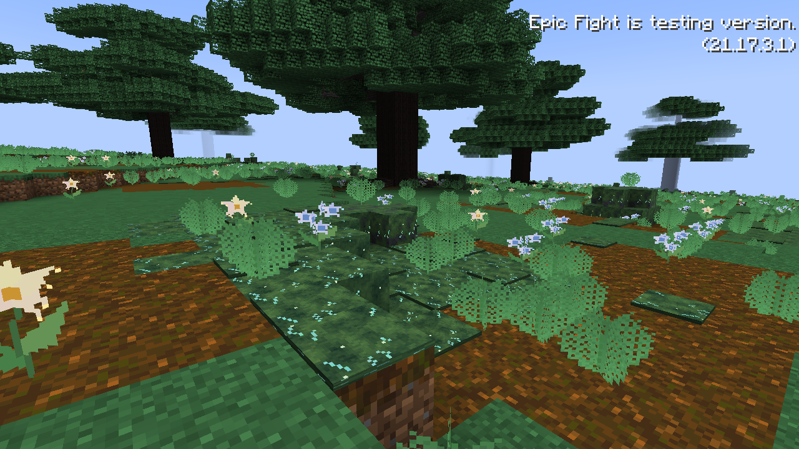
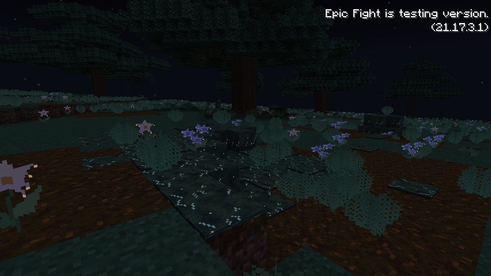
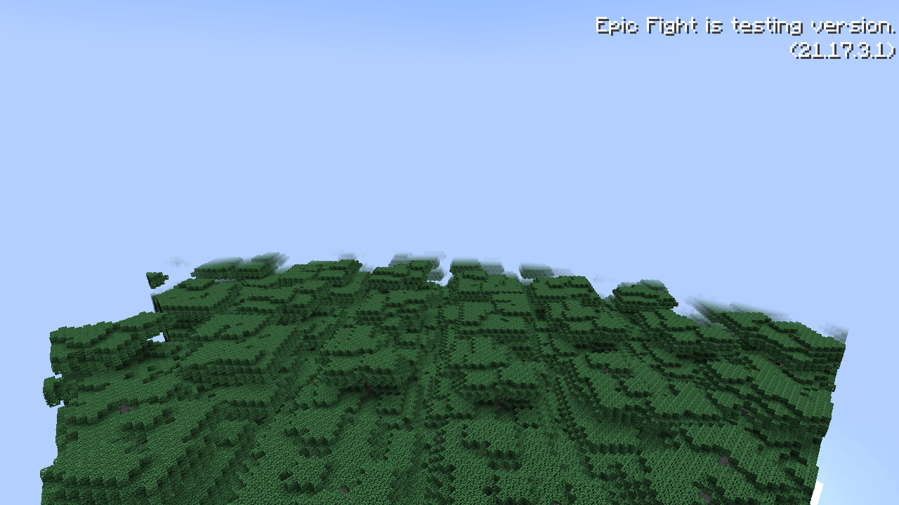

# Manaheart forest floor

This iteration uses staggered mature Heartwood anchors with young and intermediate trees between them. All ages use native Dynamic Trees branches and captured seed-grown shapes. Overlapping crowns shade the floor; the daylight preview measured skylight below 10 at 524 of 787 sampled standing positions.

Manaheart Grove's land biome gains larger, partly buried irregular boulders, two-block Whisperfrond Ferns and clumps of low woody Tangleveil Shrubs. Decorations remain ordinary configured and placed biome features. Boulders use a dedicated bounded feature rather than vanilla forest-rock blobs.

Ry is a magical wolf with native wolf behavior and an original silver-blue coat. It uses Iron's actual Gust spell against enemies. Jungle parrots, pandas and ocelots are removed from the center biome's land, river and lake spawn lists; Ry packs replace them. Other rings are unchanged.

In-game checks covered generation, daylight shading and native Gust casting. Existing chunks are not repainted.

| Name | Block ID | Appearance |
| --- | --- | --- |
| Starweave Moss | `riftfall:starweave_moss` | Deep green moss with fine, softly emissive silver-teal threads. |
| Starweave Moss Carpet | `riftfall:starweave_moss_carpet` | A low layer of the same moss. |
| Starweave Boulderstone | `riftfall:starweave_boulderstone` | Dark, moss-covered stone used for larger, partly buried boulders. |
| Whisperfrond Fern | `riftfall:whisperfrond_fern` | Two-block-tall, finely divided fronds, tinted by the biome's grass color. |
| Tangleveil Shrub | `riftfall:tangleveil_shrub` | Low woody underbrush in clustered thickets. |
| Dawnstar Blossom | `riftfall:dawnstar_blossom` | An ivory-and-gold star flower with warm emissive details. |
| Moonveil Bloom | `riftfall:moonveil_bloom` | Small silver-blue flowers with cool emissive details. |

Podzol remains Minecraft's existing soil. Moss and flowers use original 32px art, flat plant sprites and separate emissive texture layers; no blinking animation or new terrain carving is involved. The moss and its carpet use restrained luminous markings, while flowers also emit a faint, stable light level of three.

Starweave Moss is registered with Dynamic Trees as dirt-like planting soil, including a matching root-bearing soil model. Bone meal uses its own native vegetation-patch configuration, preserving magical moss and flora instead of spawning vanilla moss. Ferns drop their item with shears; other flora and moss use ordinary self-drops. Boulderstone is mined with a pickaxe. Items appear in Natural Blocks.

Regenerate art and models with `python3 tools/assets/generate-manaheart-flora.py`. In-game verification confirmed all new decorations in fresh Manaheart chunks, Heartwood soil acceptance and bone meal producing magical moss without vanilla moss. Existing generated terrain is not repainted.

